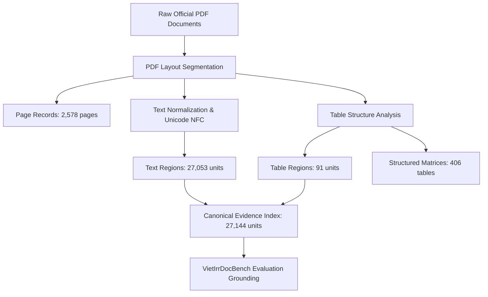

# VietIRR-RAG Dataset

**Vietnamese Irrigation Document Dataset with Structured Text, Tables, Provenance Metadata, and Evaluation Resources for Retrieval-Augmented Generation**

[](https://creativecommons.org/licenses/by-nc-sa/4.0/)
[](LICENSE)
[](https://www.python.org/)
[](scripts/verify_integrity.py)

---

## Table of Contents
1. [Overview](#1-overview)
2. [Dataset at a Glance](#2-dataset-at-a-glance)
3. [Dataset Composition](#3-dataset-composition)
4. [Repository Structure](#4-repository-structure)
5. [Data Collection and Sources](#5-data-collection-and-sources)
6. [Data Processing Pipeline](#6-data-processing-pipeline)
7. [Data Schema & Structure](#7-data-schema--structure)
8. [Quick Start](#8-quick-start)
9. [Evaluation Resources (VietIrrDocBench)](#9-evaluation-resources-vietirrdocbench)
10. [Dataset Versioning & Inconsistency Resolution](#10-dataset-versioning--inconsistency-resolution)
11. [Reproducibility & Integrity Verification](#11-reproducibility--integrity-verification)
12. [Limitations & Boundary Conditions](#12-limitations--boundary-conditions)
13. [License and Access Policy](#13-license-and-access-policy)
14. [Citation](#14-citation)
15. [Contact](#15-contact)
16. [Acknowledgements](#16-acknowledgements)

---

## 1. Overview
The **VietIRR-RAG Dataset** is an open, reproducible, and provenance-grounded benchmark corpus designed for research in **Retrieval-Augmented Generation (RAG)**, Document AI, and table reasoning over dense technical documents in the Vietnamese hydraulic and irrigation domain.

Technical documents in civil engineering, hydrology, and water management contain dense quantitative telemetry (reservoir water levels, dead storage elevations, flow rates, discharge gates), complex multi-level tables, and administrative hierarchies. Standard open-domain RAG pipelines often suffer from high hallucination rates and brittle table retrieval on such material. 

This repository provides:
- **Corpus Manifest & Provenance**: 93 official Vietnamese technical documents with verified source URLs, publication years, issuing bodies, and cryptographic SHA-256 hashes.
- **Processed Layout Evidence**: 27,144 layout-aware evidence units (27,053 text regions and 91 table regions) across 2,578 pages.
- **Structured Table Matrices**: 406 parsed table records with cell-level coordinate grids, row/column headers, and linearized representations.
- **VietIrrDocBench**: A frozen benchmark suite including **DEV-93** (93 multi-evidence evaluation items requiring cross-page or cross-document reasoning) and **ALL-QA-545** (545 curated questions).
- **Validation Tools**: Standalone scripts to verify integrity, validate JSON schemas, and stream evidence units.

---

## 2. Dataset at a Glance

| Property | Value | Verification Reference |
| :--- | :--- | :--- |
| **Dataset Version** | `V4_R6_FROZEN` (Official Operational Release) | `data/manifests/corpus_statistics.json` |
| **Historical Baseline** | `V3.2_FINAL_SEMANTIC` (89 documents) | `docs/VERSION_HISTORY.md` |
| **Document Count** | **93 official documents** | `data/manifests/corpus_manifest.csv` |
| **Total Pages** | **2,578 pages** | `data/processed/pages.jsonl` |
| **Total Evidence Units** | **27,144 units** | `data/processed/evidence_units.jsonl` |
| **- Text Region Units** | 27,053 units | `unit_type == "TEXT_REGION"` |
| **- Table Region Units** | 91 units | `unit_type == "TABLE_REGION"` |
| **Structured Tables** | 406 parsed tables | `data/processed/tables.jsonl` |
| **Benchmark QA Count** | **93 evaluation items (DEV-93)** | `benchmarks/qa/dev_93.jsonl` |
| **Full QA Pool** | 545 curated items | `benchmarks/qa/all_qa_545.jsonl` |
| **Primary Language** | Vietnamese (`vi`) | UTF-8 Unicode (NFC) |
| **Data Formats** | JSONL, CSV, JSON, SHA-256 Checksums | `schemas/` |
| **Total Staged Size** | **~58.5 MB** (Uncompressed JSONL/CSV) | Direct Git clone without LFS required |

---

## 3. Dataset Composition

The repository is structured into distinct functional tiers:
1. **Corpus Manifests (`data/manifests/`)**:
   - `corpus_manifest.csv` & `corpus_manifest.jsonl`: Tabular and JSONL manifests recording metadata, source URLs, page counts, evidence counts, and SHA-256 checksums for all 93 documents.
   - `sha256_checksums.txt`: Immutable cryptographic hashes of all original source files.
   - `corpus_statistics.json`: Aggregated corpus metadata.
2. **Processed Evidence (`data/processed/`)**:
   - `pages.jsonl`: 2,578 individual page layout records with document references and sequence numbers.
   - `evidence_units.jsonl`: 27,144 layout-aware evidence units (text paragraphs, clauses, table blocks).
   - `tables.jsonl`: 406 structured table records with cell matrices and semantic dimensions.
   - `retrieval_evidence_map.jsonl`: Parent-child mapping between coarse retrieval units (`TAB_..._P0003_01`) and fine-grained answer cells (`TAB_..._R006_C012`).
3. **Evaluation Suite (`benchmarks/qa/`)**:
   - `dev_93.jsonl`: Frozen benchmark of 93 questions testing multi-evidence, multi-hop reasoning.
   - `all_qa_545.jsonl`: Curated pool of 545 QA pairs.
   - `e2e_eval_24.jsonl`: 24 diagnostic execution traces evaluating R6 retrieval precision and generation faithfulness.
4. **Schemas & Validation (`schemas/`, `scripts/`)**:
   - Draft-07 JSON schemas for documents, evidence units, tables, and benchmark QA.
   - Standalone validation and integrity scripts.

---

## 4. Repository Structure

```text
vietirr-rag-dataset/
├── README.md                           # Main dataset documentation
├── DATASET_CARD.md                     # Hugging Face standard dataset card
├── LICENSE                             # CC BY-NC-SA 4.0 & MIT licenses
├── CITATION.cff                        # Citation File Format metadata
├── .gitignore                          # Clean repository ignore patterns
├── .gitattributes                      # Line endings and file attributes
│
├── data/
│   ├── manifests/
│   │   ├── corpus_manifest.csv         # 93 document tabular catalog
│   │   ├── corpus_manifest.jsonl       # Full metadata JSONL
│   │   ├── corpus_statistics.json      # Aggregated summary statistics
│   │   └── sha256_checksums.txt        # Cryptographic checksums (93 hashes)
│   ├── processed/
│   │   ├── pages.jsonl                 # 2,578 page records (13.6 MB)
│   │   ├── evidence_units.jsonl        # 27,144 evidence units (21.1 MB)
│   │   ├── tables.jsonl                # 406 structured table records (13.0 MB)
│   │   └── retrieval_evidence_map.jsonl# Coarse-to-fine evidence mapping (0.5 MB)
│   └── samples/
│       └── sample_evidence_units.jsonl # 20 representative inspection units
│
├── benchmarks/
│   ├── qa/
│   │   ├── dev_93.jsonl                # 93 frozen multi-evidence evaluation items
│   │   ├── all_qa_545.jsonl            # 545 full QA evaluation pool
│   │   └── e2e_eval_24.jsonl           # 24 end-to-end evaluation traces
│   ├── manifests/
│   │   └── benchmark_manifest.json     # Benchmark split descriptors
│   └── README.md                       # Evaluation benchmark guidelines
│
├── schemas/
│   ├── document.schema.json            # Manifest record schema
│   ├── evidence.schema.json            # Evidence unit schema
│   ├── table.schema.json               # Structured table schema
│   └── qa.schema.json                  # QA evaluation record schema
│
├── metadata/
│   ├── sources.csv                     # Issuing agencies and public URLs
│   ├── provenance.csv                  # Lineage from V3.2 to V4.1
│   ├── document_versions.csv           # Version cohort mapping
│   └── redistribution_policy.csv       # Public access and rights status
│
├── scripts/
│   ├── verify_integrity.py             # Verifies file integrity and checksums
│   ├── validate_dataset.py             # Validates JSON schemas and links
│   ├── summarize_dataset.py            # Prints CLI dataset summary table
│   └── download_corpus.py              # Downloads raw PDFs from official URLs
│
├── docs/
│   ├── DATA_COLLECTION.md              # Collection methodology & agencies
│   ├── DATA_PROCESSING.md              # Extraction, OCR, and table parsing
│   ├── DATA_FORMAT.md                  # Record schemas and field definitions
│   ├── VERSION_HISTORY.md              # Evolution from V3.2 to V4.1
│   ├── REPRODUCIBILITY.md              # Environment setup & validation steps
│   └── LIMITATIONS.md                  # OCR and domain boundary conditions
│
└── examples/
    └── load_dataset.py                 # Python quickstart demonstration
```

---

## 5. Data Collection and Sources

Documents were curated from publicly accessible portals of Vietnamese state management agencies and hydraulic research institutes:

| Issuing Authority | Documents | Representative Topics |
| :--- | :---: | :--- |
| **Cục Quản lý và Xây dựng công trình thủy lợi (Cục Thủy lợi)** | 56 | Weekly water resources bulletins, reservoir capacity audits, drought mitigation reports |
| **Cục Quản lý đê điều và Phòng, chống thiên tai** | 11 | SREX Vietnam disaster assessment, flood discharge summaries in Central Vietnam |
| **Viện Quy hoạch Thủy lợi Miền Nam (SIWRP)** | 8 | Salinity intrusion bulletins, Mekong Delta water resources planning |
| **Thủ tướng Chính phủ (Chính phủ)** | 7 | Inter-reservoir operating procedures (Ba, Sê San, Srêpôk, Vu Gia - Thu Bồn, etc.) |
| **Bộ Nông nghiệp và Phát triển nông thôn / Bộ TNMT** | 5 | Administrative water directives, infrastructure inspection directives |
| **Other Hydraulic Institutes** | 6 | Coastal engineering studies, reservoir sedimentation analyses |
| **Total Promulgated Documents** | **93** | **Official Hydraulic & Irrigation Corpus** |

Full URLs, publication years, and official document identifiers are provided in [`metadata/sources.csv`](metadata/sources.csv).

---

## 6. Data Processing Pipeline

The dataset was constructed through a multi-stage layout extraction pipeline:



1. **Document Ingestion**: Each PDF is cryptographically hashed (`sha256`) and broken down into individual pages.
2. **Text Normalization**: Extracted text is normalized to Unicode UTF-8 NFC. Punctuation, Vietnamese administrative capitalization, and numerical units (ha, m³, m³/s, triệu m³) are preserved.
3. **Table Parsing**: Tables are segmented into discrete cells with bounding boxes, headers, and linearized representations for LLMs.
4. **Evidence Indexing**: Units receive deterministic canonical IDs (`REG_{doc_id}_{page}_{block}` or `TAB_{doc_id}_{page}_{tab_idx}`) linked directly to their parent document SHA-256 hash.

---

## 7. Data Schema & Structure

### Example Evidence Record (`data/processed/evidence_units.jsonl`)
```json
{
  "doc_id": "IRR_CP_2018_b4331af5",
  "evidence_id": "REG_IRR_CP_2018_b4331af5_P0001_B001",
  "page_id": "PAGE_IRR_CP_2018_b4331af5_0001",
  "page_number": 1,
  "unit_type": "TEXT_REGION",
  "index_text": "CỘNG HÒA XÃ HỘI CHỦ NGHĨA VIỆT NAM\nĐộc lập - Tự do - Hạnh phúc\n\nQUYẾT ĐỊNH\nBan hành Quy trình vận hành liên hồ chứa trên lưu vực sông Vu Gia - Thu Bồn...",
  "raw_text": "CỘNG HÒA XÃ HỘI CHỦ NGHĨA VIỆT NAM...",
  "source_sha256": "b4331af55dd53bb7e096417531fb5e2db8f090d8a55959955fa6f16c7a72d73b"
}
```

Detailed JSON Schema definitions are available in [`schemas/`](schemas/):
- [`schemas/document.schema.json`](schemas/document.schema.json)
- [`schemas/evidence.schema.json`](schemas/evidence.schema.json)
- [`schemas/table.schema.json`](schemas/table.schema.json)
- [`schemas/qa.schema.json`](schemas/qa.schema.json)

---

## 8. Quick Start

### 8.1 Clone the Repository
The entire repository is ~58.5 MB uncompressed and can be cloned immediately without Git LFS:

```bash
git clone https://github.com/zudoan/vietirr-rag-dataset.git
cd vietirr-rag-dataset
```

### 8.2 Inspecting the Dataset with Python
A quickstart demonstration script is provided in [`examples/load_dataset.py`](examples/load_dataset.py):

```bash
python examples/load_dataset.py
```

### 8.3 Python Snippet for Custom Retrieval / Evaluation
```python
import json

# 1. Load document manifest
manifest = {}
with open("data/manifests/corpus_manifest.jsonl", "r", encoding="utf-8") as f:
    for line in f:
        doc = json.loads(line)
        manifest[doc["doc_id"]] = doc

print(f"Loaded {len(manifest)} documents from manifest.")

# 2. Iterate over DEV-93 benchmark questions
with open("benchmarks/qa/dev_93.jsonl", "r", encoding="utf-8") as f:
    for i, line in enumerate(f):
        item = json.loads(line)
        print(f"[{item['qa_id']}] {item['question']}")
        print(f"  Gold Docs: {item['gold_doc_ids']}")
        print(f"  Retrieval Evidence IDs: {item['retrieval_evidence_ids']}")
        if i >= 2:
            break
```

---

## 9. Evaluation Resources (VietIrrDocBench)

The repository provides the **VietIrrDocBench** benchmark suite to evaluate RAG pipelines on multi-evidence Vietnamese technical reasoning:

1. **DEV-93 (`benchmarks/qa/dev_93.jsonl`)**:
   - **93 frozen multi-evidence evaluation items**.
   - Questions specifically require combining multiple evidence blocks across different pages (`CROSS_PAGE`) or different documents (`CROSS_DOCUMENT`).
   - Every question has verified gold evidence units (`gold_evidence_ids`), retrieval targets (`retrieval_evidence_ids`), and human-verified reference answers.
2. **ALL-QA-545 (`benchmarks/qa/all_qa_545.jsonl`)**:
   - Comprehensive curated pool of 545 questions spanning core factual lookup, table extraction, and complex multi-hop synthesis.
3. **E2E Diagnostic Traces (`benchmarks/qa/e2e_eval_24.jsonl`)**:
   - 24 multi-stage diagnostic traces capturing candidate retrieval, re-ranking scores, and generation faithfulness checks.

> **Important**: Reference answers are provided strictly for evaluation metric calculation (e.g. ROUGE, BERTScore, Exact Match, Answer Faithfulness). They must never be supplied to retrieval indexes or LLM generation prompts.

---

## 10. Dataset Versioning & Inconsistency Resolution

To ensure complete scientific transparency, this section clarifies historical counts from earlier project notes:

### 10.1 Why 89 vs 93 Documents?
- **Baseline V3.2 (`LEGACY_V3_2_REFERENCE`)**: 89 documents curated during Phase 3.
- **Operational V4 Release (`V4_R6_FROZEN`)**: Incorporates 4 newly authorized official irrigation management documents (Bắc Nam Hưng operational procedures, regional water plan, Cầu Cung draft, and CT02 safety report).
- **Exact Sum**: **89 legacy documents + 4 new documents = 93 documents**.

### 10.2 Why 27,045 vs 27,144 Evidence Units?
- The 89 legacy documents contribute **27,045 evidence units** (26,954 text regions + 91 table regions).
- The 4 new V4 documents contribute **99 evidence units** across 99 pages (1 unit per page).
- **Exact Sum**: **27,045 + 99 = 27,144 evidence units**.

Refer to [`docs/VERSION_HISTORY.md`](docs/VERSION_HISTORY.md) for full lineage records.

---

## 11. Reproducibility & Integrity Verification

To verify that your local clone has zero missing files, valid JSON syntax, and intact referential integrity:

```bash
# Run automated integrity verification
python scripts/verify_integrity.py

# Run schema and referential relationship validation
python scripts/validate_dataset.py

# Print aggregated summary statistics
python scripts/summarize_dataset.py
```

All 93 source PDF SHA-256 hashes are recorded in [`data/manifests/sha256_checksums.txt`](data/manifests/sha256_checksums.txt).

---

## 12. Limitations & Boundary Conditions

Researchers utilizing this dataset should note:
- **OCR Quality**: Older scanned documents (2015-2018) contain scanning noise; while `index_text` is normalized, `raw_text` reflects original OCR output.
- **Table Complexity**: Certain tables contain deeply nested or multi-level headers. Extracted structures are flagged with uncertainty ratings in `tables.jsonl`.
- **Domain Specificity**: The vocabulary is specific to hydraulic and civil engineering. Models evaluated on this corpus should be equipped with appropriate domain tokenization.
- **Redistribution Boundary**: Raw PDF binaries are retained locally; researchers requiring raw PDFs can use `scripts/download_corpus.py` to fetch them directly from official government portals.

---

## 13. License and Access Policy

1. **Annotations and Curation**: The manifest records, layout annotations, extracted table matrices, and QA benchmark items are licensed under the **Creative Commons Attribution-NonCommercial-ShareAlike 4.0 International License (CC BY-NC-SA 4.0)**.
2. **Code & Scripts**: All scripts in `scripts/`, `examples/`, and repository root are licensed under the **MIT License**.
3. **Third-Party Documents**: Original government documents are referenced in place. The project does not claim copyright over underlying administrative regulations. See [`LICENSE`](LICENSE) for complete terms.

---

## 14. Citation

If you use the VietIRR-RAG dataset or benchmarks in your research or academic coursework, please cite:

```bibtex
@dataset{vietirr_rag_dataset_2026,
  author       = {Zu Doan},
  title        = {VietIRR-RAG Dataset: Vietnamese Irrigation Document Dataset with Structured Text, Tables, Provenance Metadata, and Evaluation Resources for Retrieval-Augmented Generation},
  year         = {2026},
  version      = {4.1.0},
  publisher    = {GitHub},
  howpublished = {\url{https://github.com/zudoan/vietirr-rag-dataset}},
  institution  = {Thuy Loi University}
}
```

Or reference the [`CITATION.cff`](CITATION.cff) file.

---

## 15. Contact
- **Author / Curator**: Zu Doan
- **Affiliation**: Thuy Loi University (Trường Đại học Thủy lợi)
- **Repository**: [https://github.com/zudoan/vietirr-rag-dataset](https://github.com/zudoan/vietirr-rag-dataset)

---

## 16. Acknowledgements
We express our sincere gratitude to:
- The **Ministry of Agriculture and Rural Development (MARD)**, **Cục Thủy lợi**, **Cục Quản lý đê điều và Phòng, chống thiên tai**, and **Viện Quy hoạch Thủy lợi Miền Nam (SIWRP)** for publishing technical reports and operating decisions that support open scientific research.
- Course instructors and faculty members at **Thuy Loi University** for technical guidance and evaluation feedback.
